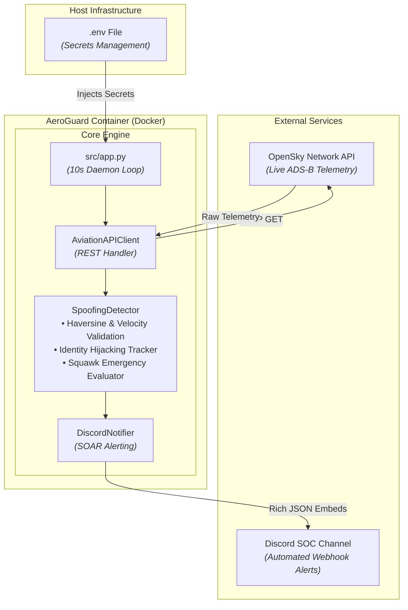
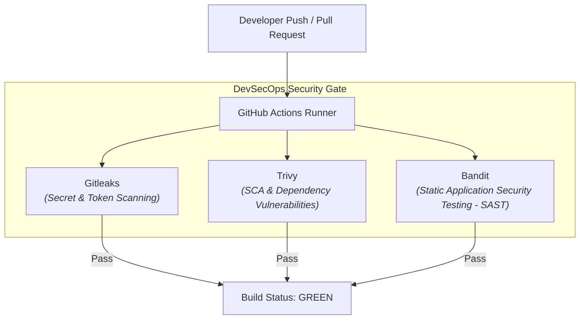

# AeroGuard — Airspace OT/IoT Threat Detection Engine

## Overview

- [Project Overview](#project-overview)
- [Architecture](#architecture)
- [Setup](#setup)
- [Writeup & Technical Deep-Dive](#writeup--technical-deep-dive)

---

## Project Overview

**AeroGuard** is an automated threat detection and incident alerting engine for critical aviation infrastructure, specifically designed to monitor Austrian airspace ($46.37^\circ\text{N} - 49.02^\circ\text{N}$, $9.53^\circ\text{E} - 17.16^\circ\text{E}$).

The civil aviation protocol **ADS-B (Automatic Dependent Surveillance-Broadcast)** is fundamentally unencrypted and unauthenticated by design. Anyone with a \$20 Software Defined Radio (SDR) or basic transmitter hardware can inject false telemetry, broadcast ghost aircraft, or spoof identity details.

AeroGuard acts as a lightweight **OT-SOC Analysis & SOAR System**:
1. **Continuous Telemetry Polling:** Fetches real-time flight vectors from the OpenSky Network.
2. **Multi-Vector Threat Detection:** Analyzes incoming states for identity hijacking, impossible physical trajectories (Haversine spatial-temporal jumps), supersonic anomalies, and emergency squawk codes.
3. **Automated Incident Response (SOAR):** Evaluates threats using a weighted scoring algorithm ($0 - 100$) to suppress false positives and immediately dispatches structured alerts via a Discord Webhook.
4. **DevSecOps Pipeline:** Fully containerized via Docker and protected by an automated CI/CD pipeline featuring Secret Scanning (Gitleaks), Dependency Scanning (Trivy), and Python SAST (Bandit).

---

## Architecture

### System Architecture



### CI/CD Security Pipeline



---

## Setup

### Prerequisites
- [Docker](https://www.docker.com/) and [Docker Compose](https://docs.docker.com/compose/) installed.
- A Discord Server with Administrator permissions (for Webhook creation).

### 1. Webhook Setup
1. In your Discord server, right-click a text channel (e.g., `#security-alerts`) and select **Edit Channel**.
2. Navigate to **Integrations** $\rightarrow$ **Webhooks** $\rightarrow$ **New Webhook**.
3. Name your webhook (e.g., `AeroGuard Sentinel`) and click **Copy Webhook URL**.

### 2. Environment Configuration
Create a `.env` file in the project root directory:

```env
DISCORD_WEBHOOK_URL=https://discord.com/api/webhooks/your/actual/webhook/url
```

*(Note: Ensure `.env` is listed in your `.gitignore` to prevent secret leakage!)*

### 3. Execution
Run the system using Docker Compose:

```bash
docker-compose up --build
```

---

## Writeup & Technical Deep-Dive

### 1. Threat Detection Methodology

ADS-B spoofing attacks range from simple identity theft to sophisticated GPS telemetry manipulation. AeroGuard implements a stateful evaluation engine to detect anomalies across three primary vectors:

#### A. Spatial-Temporal Plausibility (Haversine & Velocity Check)
To detect impossible displacement (GPS spoofing / teleportation), the system calculates the great-circle distance between consecutive position updates $(lat_1, lon_1)$ and $(lat_2, lon_2)$ using the **Haversine Formula**:

$$a = \sin^2\left(\frac{\Delta \phi}{2}\right) + \cos(\phi_1) \cdot \cos(\phi_2) \cdot \sin^2\left(\frac{\Delta \lambda}{2}\right)$$

$$c = 2 \cdot \text{atan2}\left(\sqrt{a}, \sqrt{1-a}\right)$$

$$d = R \cdot c$$

*(where $R = 6371\text{ km}$, $\phi$ is latitude, and $\lambda$ is longitude).*

If the implied velocity $v = \frac{d}{\Delta t}$ exceeds normal physical boundaries (or the speed of sound limit without military authorization), a high-severity indicator is triggered.

#### B. Identity Hijacking (Transponder Duplication)
Attackers may spoof a legitimate aircraft's ICAO24 address or Callsign. AeroGuard uses an in-memory counter pattern (`Counter`) to detect duplicate active ICAO addresses broadcasting from contradictory spatial coordinates within short timeframes.

#### C. Emergency Squawk Code Escalation
Transponder Squawk codes represent explicit pilot/system intent. AeroGuard dynamically escalates incident severity upon detecting specific 4-digit octal codes:
- **Squawk 7500:** Unlawful Interference / Hijacking (Triggers immediate maximum alert level: Red).
- **Squawk 7600:** Radio Communication Failure.
- **Squawk 7700:** General Emergency.

---

### 2. SOAR & Threat Scoring Logic

Rather than alerting on every single telemetry drop, AeroGuard aggregates indicators into a unified **Threat Score ($0 - 100$)**. 

- **Score $< 80$:** Medium Risk (Triggers a Warning embed in Discord: Yellow).
- **Score $\ge 80$ or Emergency Squawk:** Critical Risk (Triggers an Escalated Alert: High-Contrast Red).

This threshold mechanism prevents alert fatigue while ensuring zero drop rate for critical operational threats.

---

### 3. DevSecOps & Security Posture

AeroGuard was built with a **Security-by-Design** approach:

1. **Secret Scanning (Gitleaks):** Prevents accidental commits of API credentials, Webhook tokens, or private keys.
2. **Software Composition Analysis (Trivy):** Scans base container layers and Python dependencies (`requirements.txt`) for known CVEs.
3. **Static Application Security Testing (Bandit):** Inspects Python source code for unsafe functions (`eval`, `exec`, insecure random number generators, or hardcoded passphrases).
4. **Least Privilege CI/CD:** Workflows enforce minimal scope permissions (`contents: read`, `pull-requests: read`) to mitigate runner exploitation risks.

---

### 4. Key Takeaways & Future Enhancements

- **Domain Integration:** Bridging standard cybersecurity practices (SOAR, SAST) with operational technology (OT) protocols like ADS-B demonstrates how traditional IT monitoring can be adapted to Cyber-Physical Systems (CPS).
- **Future Roadmap:**
  - Integration of an ML-based trajectory prediction model (LSTM / Isolation Forests) for subtle drift detection.
  - Multi-receiver TDoA (Time Difference of Arrival) validation if local SDR hardware is attached.